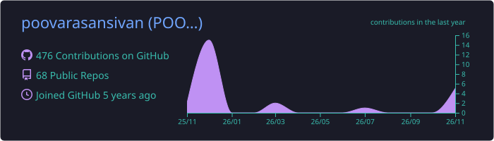
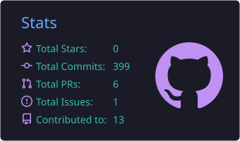
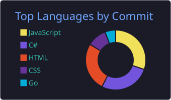

<h1 align="left">Hey 👋 I'm Poovarasan S</h1>

###

<h3 align="left">Cloud & DevOps Engineer · Chennai, India 🇮🇳</h3>

###

<h2 align="left">About me</h2>

###

<h5 align="left">
☁️ Cloud & DevOps Engineer with ~1.5 years of hands-on experience across <b>AWS</b>, <b>Azure</b> and <b>Kubernetes</b> 
⚙️ I build and run cloud infrastructure, automate deployments with CI/CD, and keep containerized workloads healthy in production 
💻 Started out as a Full Stack Web Developer (MERN, Flutter), so I understand the apps I'm shipping, not just the pipelines 
🎯 Goal: grow into a Senior DevOps / Platform Engineer, building reliable, automated and cost-efficient cloud platforms
</h5>

###

<h2 align="left">☁️ Cloud & Containers</h2>

###

  
  
  
  
  
  
  
  
  

###

<h2 align="left">🔧 IaC, CI/CD & GitOps</h2>

###

  
  
  
  
  
  
  
  
  
  
  
  
  
  
  

###

<h2 align="left">📈 Monitoring & OS</h2>

###

  
  
  
  
  
  
  

###

<h2 align="left">💻 Scripting & Development</h2>

###

  
  
  
  
  
  
  
  
  
  
  
  
  
  
  
  
  
  
  
  
  

###

<h2 align="left">📊 GitHub Stats</h2>

###

  

  
  

###
